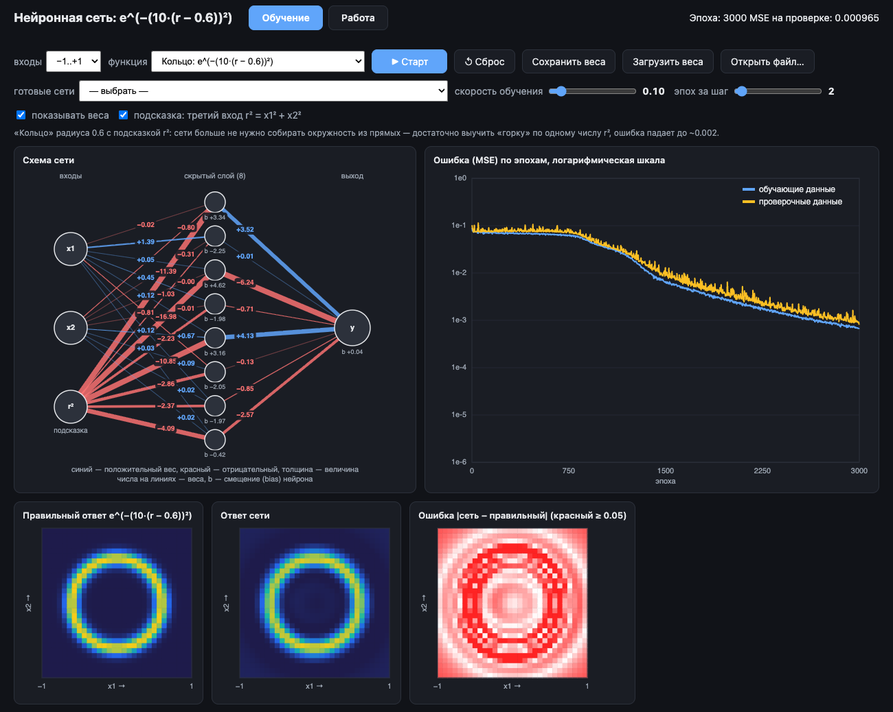

# Нейронная сеть учит функции

## ▶ [Открыть нейросеть в браузере](https://eremin-andrey.github.io/neural-net-playground/)

Работает сразу, без установки: обучение, анимация, таблица расчёта и 3D-график — всё в одном файле
[`index.html`](index.html) на чистых HTML + CSS + JavaScript. Его можно открыть и у себя двойным щелчком:
Python, сервер и интернет не нужны.

---

Крошечная нейронная сеть учится функции двух чисел x1, x2 и показывает, как она это делает.

Архитектура: **2 входа (+ необязательный третий вход-подсказка r²) → 8 скрытых нейронов (активация на выбор) → 1 выход**.
Обучение — обратное распространение ошибки (backpropagation) и стохастический градиентный спуск.
Все формулы написаны вручную, без библиотек.

## Функции

Входы x1, x2 берутся из диапазона **−1..+1** (по умолчанию) или **0..1** — переключатель «входы».

| Ключ | На входах −1..+1 | На входах 0..1 | Комментарий |
|---|---|---|---|
| `mul` | x1 × x2 | x1 × x2 | умножение (по умолчанию) |
| `add` | x1 + x2 | x1 + x2 | ответ от −2 до 2 / от 0 до 2 |
| `div` | x1 / (2 + x2) | x1 / (1 + x2) | знаменатель сдвинут, чтобы не делить на ноль |
| `xor` | (x1>0) XOR (x2>0) | (x1>0.5) XOR (x2>0.5) | «ступенька»: трудна для сети, учится медленно (lr 0.05–0.1, тысячи эпох) |
| `absdiff` | \|x1 − x2\| | \|x1 − x2\| | «гладкий XOR», учится легко |
| `pow` | — | x1 ^ x2 | степень; на −1..+1 не определена: (−0.5)^0.5 — комплексное число, 0^(−0.5) — бесконечность. На 0..1: 0⁰ = 1, у оси x1 = 0 резкий край |
| `exp` | e ^ x2 | e ^ x2 | зависит только от x2 — сеть учится не обращать внимания на x1 |
| `hat` | sin(5r) / (5r) | то же | «сомбреро»: горка и круговые волны, r = √(x1² + x2²) |
| `egg` | sin(πx1) · cos(πx2) | то же | «яичная коробка»: холмы и впадины |
| `ring` | e^(−(10·(r − 0.6))²) | то же | «кольцо» радиуса 0.6: без подсказки маленькая сеть почти не учится |

### Подсказка r²

Галочка «подсказка: третий вход r² = x1² + x2²» добавляет сети третий входной нейрон —
квадрат расстояния до центра. «Круглым» функциям это резко помогает, остальным — нет:

| Функция (входы −1..+1, 1500 эпох) | без подсказки | с подсказкой |
|---|---|---|
| кольцо | MSE ~0.08 (почти не учится) | ~0.002 |
| сомбреро | ~0.006 | ~0.0001 |
| умножение | ~0.00006 | ~0.0002 (лишний вход только мешает) |

Это пример конструирования признаков (feature engineering): от того, *что* подать на вход, задача
может стать из почти невыполнимой простой. «Честная» альтернатива — второй скрытый слой с функцией tanh
(в опытах снижал ошибку на кольце до ~0.006–0.009), но в проекте он пока не реализован.

### Функции активации

Список «активация» задаёт функцию h = f(z) скрытых нейронов; рядом — её мини-график.

| Активация | Формула | Яичная коробка | Сомбреро | Умножение | Скорость обучения |
|---|---|---|---|---|---|
| сигмоида (по умолчанию) | 1 / (1 + e^(−z)) | 0.012 | 0.0054 | 0.00001 | 0.3 |
| tanh | (e^z − e^(−z)) / (e^z + e^(−z)) | 0.0078 | 0.0015 | 0.00001 | 0.1 |
| ReLU | max(0, z) | 0.11 | 0.028 | 0.0009 | 0.03 |
| Leaky ReLU | max(0.01·z, z) | 0.11 | 0.028 | 0.0010 | 0.03 |
| гауссиана | e^(−z²) | **0.0016** | **0.0003** | 0.00007 | 0.1 |

MSE на проверке, медиана 3 запусков, 1500 эпох, входы −1..+1, без подсказки r², при лучшей из скоростей 0.3 / 0.1 / 0.03.
С ReLU ответ сети собирается из плоских граней (хорошо видно на 3D-графике) — восьми «изломов» мало для гладких холмов.
Гауссиана делает каждый нейрон «гребнем», а не «ступенькой» — для холмов это лучше всего.
Кольцо без подсказки r² не выучила ни одна активация (MSE ~0.075–0.096).

## Как пользоваться

**Вкладка «Обучение»** — выберите диапазон входов и функцию (сеть при этом сбрасывается),
нажмите «▶ Старт» и смотрите:
- схема сети: синие связи — положительные веса, красные — отрицательные, толщина — величина;
- график ошибки MSE (Mean Squared Error — среднеквадратичная ошибка) в логарифмической шкале;
- три карты: правильный ответ, ответ сети и их разница (красное — где сеть ошибается);
- **объёмный график** z = f(x1, x2): мышью можно вращать, колесом — менять наклон, «↺ Вид» — исходный ракурс.
  Режимы: только функция, только ответ сети или обе сразу (функция — тонкой сеткой, ответ сети — поверхностью).

Ползунок «скорость обучения» — размер шага градиентного спуска (слишком большой — ошибка «разойдётся»).
«Эпох за шаг» — ускоряет обучение.

**Вкладка «Работа»** — двигайте ползунки x1 и x2: сеть сразу считает ответ,
показывает точное значение, ошибку и активацию каждого нейрона.
- **Проход сигнала** — анимация: от входов к скрытым нейронам бегут точки
  (размер — величина вклада вес × значение, цвет — знак), нейроны «загораются»,
  затем сигнал идёт к выходу. Запускается кнопкой и автоматически после смены входов.
- **Объёмный график** с белой точкой — ответом сети в текущих x1, x2.
- **Таблица расчёта** — весь счёт сети по шагам для каждого скрытого нейрона:
  w₁·x1, w₂·x2 (и w₃·r²), смещение b, сумма z, активация h = f(z), выходной вес и вклад h·w_вых;
  внизу — сумма вкладов + смещение выхода = ответ сети.

**Сохранение сетей**
- **Готовые сети** — встроенные обученные веса: кольцо с подсказкой r², умножение, XOR-ступенька с r².
- **Сохранить веса** — скачивает файл `.json` и запоминает его в браузере;
  **Загрузить веса** — берёт запомненное в браузере для текущей функции; **Открыть файл…** — загружает любой файл весов.
- Последняя сеть запоминается при закрытии страницы и восстанавливается при открытии (график ошибки — нет).

## Файлы

| Файл | Что это |
|---|---|
| `index.html` | **Основная версия**: вся программа в одном файле (сеть, обучение, интерфейс, готовые веса) |
| `нейросеть.html` | Старое имя страницы — перенаправляет на `index.html` |
| `docs/screenshot.png` | Скриншот для этого README |
| `python/` | Прежняя Python-версия (см. ниже) |

## Python-версия (`python/`)

С неё проект начинался; новые возможности теперь появляются в `index.html`, а Python-версия остаётся
рабочей, но может отставать. Файлы весов у обеих версий одного формата и взаимозаменяемы,
расчёты на одних и тех же весах совпадают до последнего знака.

| Файл | Что делает |
|---|---|
| `python/network.py` | Нейросеть на чистом Python (без numpy): прямой проход, обучение, сохранение/загрузка весов |
| `python/train.py` | Обучение в терминале |
| `python/web_app.py` + `python/web/index.html` | Визуализация в браузере через локальный сервер (обучение идёт в Python) |
| `python/weights*.json` | Обученные веса (они же встроены в `index.html` как «Готовые сети») |

Запуск (из папки `python`):

    cd python
    python3 web_app.py                   # сервер, откроется http://127.0.0.1:8765; остановить — Ctrl+C
    python3 train.py                     # обучение в терминале: 1500 эпох, lr=0.5, умножение на 0..1
    python3 train.py --func ring --domain pm1 --r2 --lr 0.1   # кольцо с подсказкой → weights_ring_pm1_r2.json

Имена файлов весов: `weights.json` — умножение на 0..1, иначе `weights_<функция>[_pm1][_r2][_<активация>].json`.
Python-версия умеет только сигмоиду: файл с другой активацией она откажется загружать с понятным сообщением.
